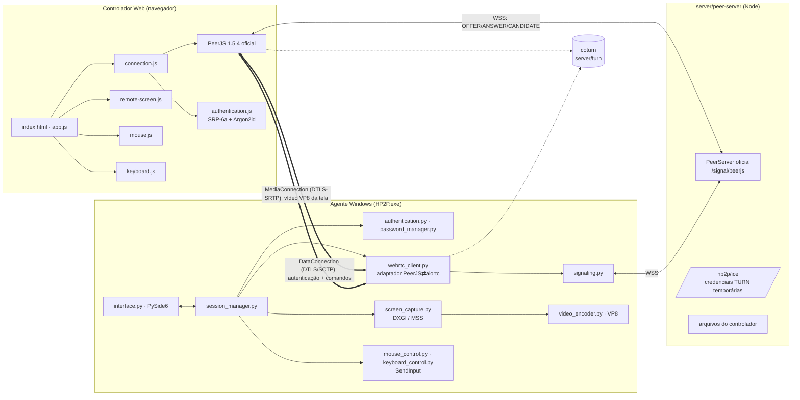

# HP2P — Arquitetura

## Visão geral



* **Padrão:** a sinalização é feita pelo **PeerJS Cloud** público (`wss://0.peerjs.com`, chave `peerjs`), com
  STUN do Google e TURN públicos do PeerJS. O diagrama abaixo mostra a opção com **servidor próprio**
  (`server/peer-server` + coturn), que segue suportada; o fluxo da sessão é idêntico nos dois casos.
* O **servidor** só ajuda os peers a se encontrarem e trocarem SDP/ICE. Ele nunca vê senhas,
  imagens nem comandos: tudo isso trafega fim-a-fim dentro do WebRTC (DTLS/SRTP).
* A conexão é **P2P direta** sempre que possível; quando não for (NAT simétrico, UDP bloqueado), o
  ICE usa o **TURN** (coturn) com credenciais temporárias emitidas por `GET /hp2p/ice`.

## Duas conexões PeerJS por sessão

| Conexão | Quem inicia | Uso |
|---|---|---|
| `DataConnection` (`serialization: "json"`) | navegador | autenticação, autorização, comandos de mouse/teclado, ping, qualidade |
| `MediaConnection` | agente | trilha de vídeo da tela (sendonly → recvonly) |

O agente **não aceita** mídia vinda do navegador e só chama o navegador depois da autorização local.

## Sequência de uma sessão

```
Navegador                        PeerServer                       Agente (aiortc)
  | peer.connect(hp2p-<ID>) ------> OFFER ----------------------------> |
  | <------------------------------ ANSWER (todos os candidatos no SDP) |
  |==================== DataChannel aberto (DTLS) ======================|
  | hello {A} --------------------------------------------------------> |  limitador de tentativas
  | <------------------------------------ challenge {sid, creds[s, B]}  |  1 desafio por tentativa
  | Argon2id(senha) → SRP → proof {M, bind} --------------------------> |  verifica M e o vínculo DTLS
  | <------------------------------------------ auth-ok {HAMK, bind}    |  navegador verifica o agente
  | <------------------------------------------- auth-wait-local        |  janela de autorização
  |                                                                     |  (mídia é preparada em paralelo)
  | <------------------------------------ authorized {permissão, tela}  |
  | <------------------------- OFFER media ---------------------------- |
  | <------------------------------------ media-offer {fp da oferta}    |
  | confere fp, call.answer() → ANSWER -------------------------------> |
  | media-answer {fp da resposta} ------------------------------------> |  confere fp → libera quadros
  |<=================== vídeo VP8 (SRTP) ===============================|
  | m/k/sc (mouse, teclado, atalhos) ---------------------------------> |  permissão + limite de taxa
  | ping a cada 4 s ---------------------------------------------------> |  silêncio > 20 s = queda
```

## Compatibilidade PeerJS × aiortc (validada)

| Item | Resultado |
|---|---|
| Sinalização | aiortc não tem; `signaling.py` implementa o cliente do protocolo PeerServer (registro, HEARTBEAT, reconexão com o mesmo ID). |
| SDP | Compatível sem alterações. |
| ICE | aiortc não faz trickle: os candidatos vão no SDP. Coleta STUN leva ~5 s nesta máquina (por isso a mídia é preparada durante a autorização). |
| DTLS | Compatível. **Achado:** o aiortc anuncia fingerprints sha-256/384/512 e o Chrome guarda só a sha-512 na `remoteDescription`; o vínculo usa sempre a fingerprint mais forte presente. |
| SCTP / DataChannel | Compatível; serialização `json` do PeerJS (JSON UTF-8 em frames binários). `binary` (BinaryPack, padrão do PeerJS) não é suportada: o controlador usa `json`. |
| MediaStream | Compatível: PeerJS recebe a chamada do aiortc no evento `call`; VP8 negociado. |

## Captura e vídeo

* **DXGI Desktop Duplication** (dxcam): ~10 ms/quadro 1080p incluindo cursor e conversão. Padrão.
* **MSS/GDI**: ~56 ms/quadro na mesma máquina. Reserva automática.
* Presets: baixa 960 px/8 fps · média 1280 px/15 fps · alta 1920 px/24 fps. O modo automático baixa
  a qualidade quando o navegador mede perda > 3 % ou quadros descartados e sobe após ~20 s estável;
  o agente também reduz quando a captura não acompanha o FPS. Bitrate VP8 até 4 Mbps (REMB).
* Monitor 1 = **monitor principal**; o mesmo retângulo é usado no mapeamento do mouse.

## Módulos do agente

| Arquivo | Responsabilidade |
|---|---|
| `main.py` | ponto de entrada, log, instância única |
| `interface.py` | PySide6: janela principal, autorização, indicador de sessão, configurações, bandeja |
| `session_manager.py` | serviço, ciclo de vida da sessão, permissões, roteamento de comandos |
| `authentication.py` | SRP-6a + vínculo ao canal DTLS |
| `password_manager.py` | senhas automática/personalizada/temporária; só verificadores |
| `identity.py` | ID público de 9 dígitos |
| `security.py` | DPAPI, bloqueio por tentativas, limitador de taxa |
| `signaling.py` / `webrtc_client.py` | adaptador PeerJS ⇄ aiortc (isolado) |
| `screen_capture.py` / `video_encoder.py` | captura e trilha de vídeo |
| `mouse_control.py` / `keyboard_control.py` / `win_input.py` | SendInput |
| `config.py` | configuração externa (`%APPDATA%\HP2P`) |
