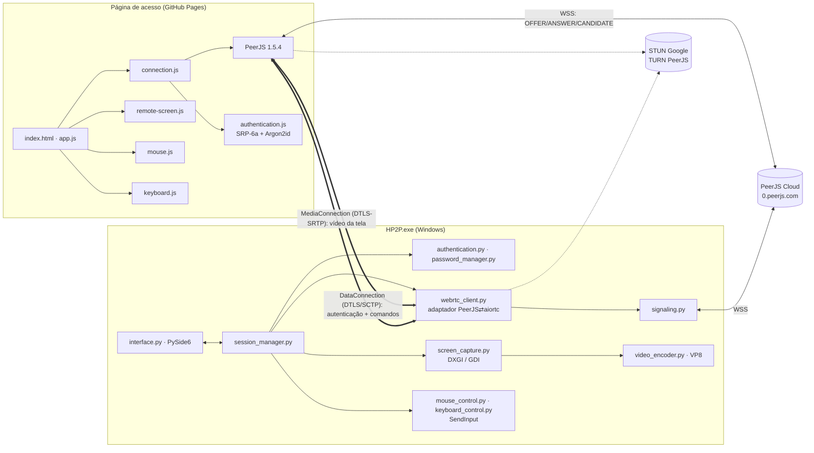

# HP2P — Arquitetura

## Visão geral



* **Sinalização:** o PeerJS Cloud só apresenta os dois lados (IDs, SDP e ICE). Senhas, tela e comandos
  trafegam fim-a-fim pelo WebRTC.
* **Conexão:** é P2P direta sempre que possível. Quando não é, o ICE usa os servidores TURN públicos do
  PeerJS, e o tráfego continua cifrado.
* **Distribuição:** a página de acesso é a pasta `web-controller/`, publicada no GitHub Pages pelo workflow
  `.github/workflows/pages.yml`. O agente é um único `HP2P.exe`, publicado em Releases.

## Sessão

| Conexão PeerJS | Quem inicia | Uso |
|---|---|---|
| `DataConnection` (`serialization: "json"`) | navegador | autenticação, autorização, mouse/teclado, ping, qualidade |
| `MediaConnection` | agente | vídeo da tela (sendonly → recvonly) |

```
Navegador                        PeerJS Cloud                     HP2P.exe (aiortc)
  | connect(hp2p-<ID>) ----------> OFFER ----------------------------> |
  | <------------------------------ ANSWER (candidatos no SDP) -------- |
  |==================== DataChannel (DTLS) ============================|
  | hello {A} --------------------------------------------------------> |  limite de tentativas
  | <------------------------------------ challenge {sid, s, B}         |  desafio de uso único
  | Argon2id(senha) → SRP → proof {M, bind} --------------------------> |  verifica M e vínculo DTLS
  | <------------------------------------------ auth-ok {HAMK, bind}    |  navegador verifica o agente
  | <------------------------------------ authorized {permissão}        |  após "Aceitar" no computador
  | <------------------------- OFFER media + media-offer {fp} --------- |
  | confere fp → ANSWER, media-answer {fp} ---------------------------> |  confere fp → libera quadros
  |<=================== vídeo VP8 (SRTP) ===============================|
  | m / k / sc (mouse, teclado, atalhos) -----------------------------> |  permissão + limite de taxa
```

## Segurança

* **ID:** 9 dígitos públicos. Só localizam o computador; não autenticam nada.
* **Senha:** automática (12 caracteres, nova a cada início), personalizada ou temporária. O agente guarda
  só o verificador SRP-6a (RFC 5054) calculado sobre Argon2id(senha, 64 MiB), cifrado com DPAPI em
  `%APPDATA%\HP2P\credentials.bin`.
* **Autenticação:** SRP-6a mútuo. A senha nunca trafega, e cada tentativa usa efêmeros novos (sem replay).
  O HAMK prova a identidade do agente.
* **Vínculo ao canal:** HMAC(K, fingerprints DTLS vistas por cada lado). Se a sinalização trocar SDPs para
  ficar no meio (MITM), a sessão é recusada. A mídia só é liberada depois de conferir a fingerprint da
  MediaConnection pelo canal já autenticado.
* **Ordem senha → autorização local:** o ID é público. Pedir a senha antes da janela de autorização impede
  que qualquer pessoa faça o computador abrir solicitações.
* **Bloqueio:** 5 falhas em 5 min bloqueiam novas tentativas por 5 min, dobrando a cada novo bloqueio.
  Também há limite de 20 tentativas de conexão por minuto e uma sessão por vez.
* **Controle:** só eventos de mouse/teclado de uma lista fixa (SendInput), com limite de 400 eventos/s e
  permissões por sessão (visualizar, mouse, mouse e teclado). Tudo é liberado ao desconectar. Não existe
  caminho para executar comandos.
* **Limitações do Windows:** Ctrl+Alt+Del e janelas de administrador ou do UAC não recebem entrada de um
  processo comum (UIPI).
* **PeerJS Cloud (terceiro):** vê IDs e endereços IP dos peers. Não vê senhas, tela nem comandos. Não há
  garantia de disponibilidade.

## Compatibilidade PeerJS × aiortc

| Item | Resultado |
|---|---|
| Sinalização | aiortc não tem; `signaling.py` implementa o cliente do protocolo PeerServer (registro, HEARTBEAT, reconexão com o mesmo ID). |
| SDP / DTLS | Compatíveis. O aiortc anuncia fingerprints sha-256/384/512 e o Chrome guarda só a sha-512; o vínculo usa sempre a mais forte. |
| ICE | aiortc não faz trickle; os candidatos vão no SDP. A coleta STUN leva ~5 s, por isso a mídia é preparada durante a autorização. |
| DataChannel | Serialização `json` do PeerJS. A `binary` (BinaryPack, padrão do PeerJS) não é suportada; a página usa `json`. |
| MediaStream | O PeerJS recebe a chamada do aiortc no evento `call`; VP8 negociado. |

## Captura e vídeo

* **DXGI Desktop Duplication** (dxcam): ~10 ms/quadro em 1080p. É o padrão.
* **GDI** (mss): ~56 ms/quadro. É a reserva automática.
* **Monitor:** o 1 é sempre o monitor principal, e o mesmo retângulo converte as coordenadas do mouse.
* **Qualidade:** baixa (960 px/8 fps), média (1280 px/15 fps) e alta (1920 px/24 fps). No modo automático
  ela muda conforme a perda medida no navegador e o tempo de captura. Bitrate VP8 até 4 Mbps.

## Módulos do agente

| Arquivo | Responsabilidade |
|---|---|
| `main.py` | entrada, log, instância única, `--selftest` |
| `interface.py` | PySide6: janela principal, autorização, indicador de sessão, configurações, bandeja |
| `session_manager.py` | serviço, ciclo da sessão, permissões, roteamento de comandos |
| `authentication.py` / `password_manager.py` | SRP-6a + vínculo DTLS / senhas e verificadores |
| `identity.py` · `security.py` · `config.py` | ID público · DPAPI e limitadores · configuração em `%APPDATA%\HP2P` |
| `signaling.py` / `webrtc_client.py` | adaptador PeerJS ⇄ aiortc |
| `screen_capture.py` / `video_encoder.py` | captura e trilha de vídeo |
| `mouse_control.py` / `keyboard_control.py` / `win_input.py` | SendInput |
| `selftest.py` | diagnóstico (`HP2P.exe --selftest`) |

## Gerar o HP2P.exe

```bash
cd agent && uv venv --python 3.12 .venv && uv pip install --python .venv\Scripts\python.exe -r requirements.txt pyinstaller
cd .. && agent\.venv\Scripts\python build\build_agent.py
```

Gera `dist\HP2P.exe`: arquivo único do PyInstaller (`build/hp2p.spec`) com Python, Qt, aiortc/FFmpeg e as
demais bibliotecas. Ele se descompacta em `%TEMP%` a cada abertura (~7 s) e apaga a pasta ao sair. Para
publicar, anexe o arquivo a um release do GitHub.
